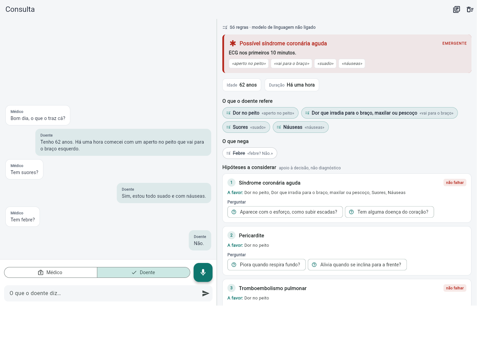

# SymptomBridge

The patient describes their symptoms out loud, before the appointment (waiting room, at home) or during it. SymptomBridge transcribes, structures what was said and puts it on the clinician's screen: findings with the exact words they came from, red flags, and conditions to consider, each with what supports it, what argues against and what to ask next.

> Portfolio project. Not a medical device. It never gives the patient a diagnosis; everything goes to a clinician, who decides.

**▶ Try it: [margaridafpereira.github.io/symptombridge](https://margaridafpereira.github.io/symptombridge/)** · straight to an example: [?caso=c01](https://margaridafpereira.github.io/symptombridge/?caso=c01)



## One app, two moments

- **Consultation:** the device sits on the desk and listens. Tap *Médico* or *Doente* for who is speaking (the browser's speech recognition can't tell voices apart). The clinician's panel updates as they talk, and its suggested questions can be tapped straight into the conversation.
- **Pre-visit:** in the waiting room or at home, the app interviews the patient: safety questions first (chest pain → does it spread to the arm? any sweating?), then whatever best separates the possibilities. Big yes/no buttons, or answer in your own words. If an emergency red flag fires, the patient is told what to do (alert staff, call 112), never why. At the end, *Enviar ao médico* opens the same clinician panel.

Speech uses the browser's recognition (Chrome, Edge) in European Portuguese; anywhere else you can type, or load one of the fictional cases.

## The engine, measured honestly

The core (`engine/`, pure Dart) turns Portuguese speech into findings, red flags and hypotheses. Rules and an explicit knowledge base, no AI model yet, so it can't invent symptoms and every output points back to the patient's words.

It's checked against fictional cases (`eval/`):

| | Development set (20 cases) | Challenge set (10 cases) |
|---|---|---|
| Findings recalled | 100 % | **44 %** |
| Red flags caught | 8 / 8 | **0 / 4** |
| False red flags | 0 | 1 |
| Right condition in top 3 | 100 % | **43 %** |

The development set was written alongside the rules, so of course it scores 100 %. The challenge set was written afterwards to break it, and is never tuned against. It did:

- "ficou com a cara à banda e não consegue levantar o braço" (a stroke, in a relative's words) → no red flag;
- "às vezes penso que era melhor não estar cá" → no suicide-risk flag;
- "soares frios" (speech recognition mishearing "suores") → missed cardiac flag;
- "o meu pai morreu de enfarte" → counted as the patient's own heart disease (false alarm);
- "moinha", "tripa solta", "deitei tudo fora" → not understood.

That's the point of measuring: a hand-written lexicon handles the textbook phrasing and falls apart on how people actually talk. See [eval/report.md](eval/report.md) for every miss.

## Run it

```bash
cd engine
dart run example/demo.dart     # one transcript in, assessment out
dart test                      # both evaluation sets, report in eval/report.md
cd ../app && flutter run -d chrome
```

## The language-model layer (built, waiting for a key)

To understand how people actually talk, a model reads the transcript on top of the rules. It's free: Google's Gemini free tier, called through a small Cloudflare Worker ([worker/worker.js](worker/worker.js)) that keeps the key secret, only answers this site and only does this one task.

Safety is in the code, not just the docs ([engine/test/merge_test.dart](engine/test/merge_test.dart)):

- the model can **add** findings and red flags, never delete what the rules found; a disagreement becomes a note for the clinician;
- every model finding must quote words that really are in the transcript, or it's thrown away;
- the only thing it can take away is history that belongs to someone else ("o meu pai morreu de enfarte");
- if the model is down or out of quota, the rules still answer.

```bash
SYMPTOMBRIDGE_API=https://symptombridge-api.<account>.workers.dev dart test   # adds the "rules + model" rows
```

## Next

- Run the challenge set with the model and publish the before/after.
- Patient and clinician on different devices (a small sync service), and English for the interface.
